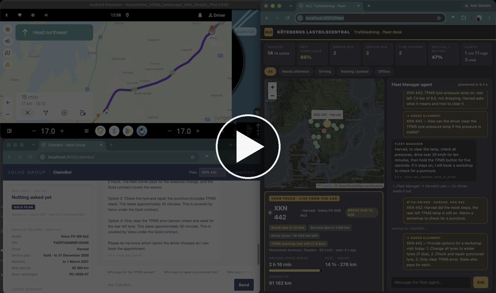
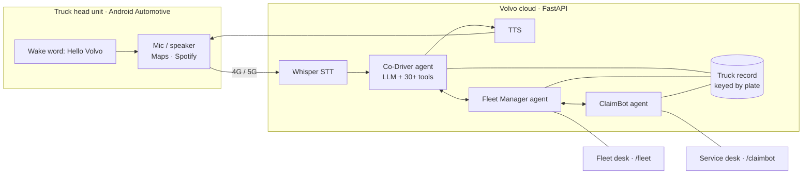

# Volvo Smart Vehicle — Co-Driver, ClaimBot and Fleet Manager

**Three AI agents working on one truck record.** Co-Driver in the cab, ClaimBot at the service desk, Fleet Manager in the haulier's office — for **commercial vehicles** (long-haul trucks, buses, heavy machinery: Volvo Group, not Volvo Cars).

This is not a voice assistant bolted onto a cockpit. It is not Alexa, not Google Assistant, not phone mirroring. It is Volvo's own system, built in-house end to end: the driver says **"Hello Volvo"** and just talks, and the fleet office and the customer are already in the loop.

**In a hurry?** [Watch the demo](#watch-the-demo) (10 min) · [Architecture](#architecture) · [How it's built](#how-its-built) · [About the source code](#about-the-source-code)

> This is the demo repository: the recording, the slides and a description of how the system works. The source code is private and **can be reviewed on request** — see [About the source code](#about-the-source-code). This project belongs to Harvad Li. You may view it, but nothing here may be used without the owner's written permission — see [Ownership and use](#ownership-and-use).

| | |
|---|---|
| **What it is** | A working prototype: voice agent on an Android Automotive head unit, plus two desk agents, all sharing one vehicle record |
| **Stack** | Kotlin · Android Automotive OS · Python · FastAPI · Whisper · Ollama (Gemma 4 12B) · MLX · Docker |
| **Agent design** | LLM tool-calling loop with 30+ tools; agents call each other (cab → Fleet Manager → ClaimBot → back) |
| **Runs on** | One MacBook for development: local LLM, local speech-to-text, Android Automotive emulator. No cloud AI service. |
| **Speed** | About 1 s for a direct voice question; 3–4 s when a turn crosses all three agents |

## Watch the demo

One shift on the E20, three agents, about 10 minutes. Press play:

https://github.com/user-attachments/assets/56f50f30-22ff-48d0-af14-e1896f48e722

- **Full quality** — [watch the recording on Google Drive](https://drive.google.com/file/d/1u1qIA6HCn9VLD2NqWwFMMV02MR_s5Lue/view?usp=sharing); no sign-in needed.
- **Slides** — [open them in your browser](https://bluehawana.com/codriver/slides/); arrow keys to navigate. Everything on the slides is also written out below.

On screen: the truck's Android Automotive head unit (left), the haulier's Fleet Manager desk (right) and Volvo Group's ClaimBot (bottom). Every hand-off between them is a real agent turn.

| Time | Chapter | What happens |
|---|---|---|
| 0:00 | Route planning and fuel stop | "Hello Volvo." Co-Driver gives the day: arrival time, the dock, the break that is due — and a stop where the driver can rest and refuel. Maps routes there. |
| 1:09 | Dashboard alert and tyre pressure | A tyre-pressure lamp comes on. Co-Driver reads the sensors (rear left 7.4 of 8.0 bar, not dropping), says it is safe to the next stop, and gets the reset steps from the manual via Fleet Manager and ClaimBot. |
| 2:19 | Booking the tyre job | The lamp stays on. The desk offers three choices — full studded winter set, puncture check only, or just clear the TPMS error — with who pays for each. The driver decides; the slot is booked at Volvo Truck Center Örebro. |
| 3:31 | Winter tyre rules | Co-Driver checks that studded tyres are legal on that date and that the swap follows the fleet's own wiki policy. |
| 4:46 | Delivery and new pickup | The customer changes the plan: new address, dock, deadline. The request goes to the haulier, Fleet Manager turns it into an instruction with the mandatory rest included, Co-Driver reads it out and re-routes. |
| 7:06 | Weather, stock, music | The table stakes any assistant has: local weather, the Volvo AB share price, "Shape of My Heart" on Spotify. |

Chapter times are from the recording's auto-generated chapters.

## Why this project

**The signal.** America's largest electric-truck order — 2,500 trucks — went to Tesla, with Volvo second. Tesla won on intelligence; we competed on range, with a cab that isn't smart. The shift to intelligent commercial vehicles is happening now.

**The crossroad.** Powertrain, gearbox and engine are still Volvo's edge, and we keep them. But the next decade is won on the software around the truck, not only the powertrain under it. The cab is the new battlefield: leather, logos and lights don't beat Tesla Semi or Sany. Intelligent, informative software does.

**Three chairs run every shift.** Demands come from the cab, the fleet office and the customer's goods-in desk. A cockpit assistant hears only one of them.

| Chair | What they ask | What the system does |
|---|---|---|
| **The driver** | "Break in 15 minutes — where, and can I fuel there?" "There's a tyre symbol on my dashboard. Is it safe to drive on?" | Rest planning, fuel, warning lamps, the handbook — answered in one breath, eyes on the road. |
| **The fleet manager** | "XKN 442 — winter tyres today without losing a day?" | Finds the Volvo Truck Center on that route, a slot during the customer stop, the tyre set from the depot. Booked, driver told. |
| **The customer** | "Change of plan: unload at our storage yard, Radiatorvägen 7. Dock C, crew leaves at 17:00." | Read out, applied, confirmed back, re-routed. Today that is a phone call to a driver who is driving. |

## What the three agents do

A truck is never alone. A driver, a fleet office and a customer's warehouse run every shift together, so one system has to serve all three chairs.

| Agent | Where | What it does |
|---|---|---|
| **Co-Driver** | In the cab, voice in and voice out | Wakes on "Hello Volvo". Knows the plate, the EU driving-time clock, the service book and the warning lamps. Proactive: it speaks before the driver asks — break due, fuel, arrival. Every answer is one sentence, eyes on the road. |
| **ClaimBot** | At the service desk (Volvo Group) | Plate first, then the contract tier, warranty and open campaigns. Says who pays, reads the workshop manual, books the workshop slot, drafts the claim. |
| **Fleet Manager** | In the haulier's office | Every truck live: position, rest compliance, range, tyres, faults — exceptions first. The hub: it talks to any driver, asks ClaimBot, and passes the customer's requests on to the cab. |

All three read and write **one record, keyed by the registration plate**: VIN, model, service book, contract and warranty, tyres, driving-time clock, telemetry and faults, dispatch log. That is why they can hand work to each other instead of starting over.

What this gives each driver and each truck:

- **Rest time** — tracks the EU driving clock and proposes the stop before the break is due.
- **Refuelling** — picks a stop that fits the break and the remaining range.
- **Workshop booking** — finds the Volvo Truck Center on the route and books a slot around the delivery, with who-pays settled before the truck arrives.
- **Dashboard warnings** — explains the lamp or message, says whether it is safe to drive on, and walks the driver through the reset. If it stays on, it books the diagnostic; it never pretends to clear a fault itself.
- **Customer changes** — a new address, dock or deadline reaches the driver as one spoken instruction, and the route is updated.
- **Everything else by voice** — navigation, weather, music, markets, web search.

## Why it has to be Volvo's own

- **Data sovereignty** — voice, telemetry, fleet and customer data stay in Volvo's own cloud. No assistant vendor in the loop.
- **Deep integration** — the service book, the contract and the fleet are data no third-party assistant can be given, so none can do this.
- **Any LLM** — no ecosystem lock-in. Gemma 4 on our own servers today, whatever is best tomorrow.
- **No smartphone needed** — only the vehicle computer and a SIM card. CarPlay and Android Auto are phone mirroring; they know nothing about the truck.

### Everything Volvo Cars has, we have. What we have, they don't.

| Volvo Cars · Google built-in — we have all of this too | Volvo Group · three agents, one record — only we can build this |
|---|---|
| Voice assistant: wake word, natural speech, any language | **Co-Driver** — the truck's own agent: paired to the plate, EU driving time, service book, workshop procedures, faults |
| Navigation with live traffic (Google Maps) | **ClaimBot** — claims and service desk on the same record: contract tiers, warranty, standard times, claims drafted and validated |
| Music, radio, podcasts (Spotify) | **Fleet Manager** — the whole fleet, exceptions first; talk to any driver, book any workshop, from one screen |
| Weather, markets, open knowledge | **One record, one identity** — driver, customer and fleet office see the same truth and act on it together |
| Phone projection (CarPlay / Android Auto) | Built on data no third party can be given, so no third party can replace it |

### What this means for Volvo Group

From a cockpit system to an ecosystem:

1. **Paired to the plate, pre-loaded with Volvo-internal knowledge** — service book, workshop procedures, contracts, fleet and uptime data. A public assistant can never be given this.
2. **Driver, service desk and fleet office on one record** — uptime, claims and dispatch stop being three phone calls.
3. **One platform, any brand** — Hello Volvo, Hello Renault, Hello Mack.
4. **A blue ocean** — fewer competitors and higher margins than trucks sold on price and payload.
5. **From products to products plus services** — subscriptions per truck, per fleet, per contract tier. Recurring and Volvo-owned.

### The ask

> If not us, who? If not now, when?

1. Approve a pilot of the three-agent system on real Volvo trucks — the hardest part is already proven.
2. Keep it in-house: Volvo's voice, Volvo's data, Volvo's intelligence layer across cab, desk and office.
3. Make the intelligent vehicle ecosystem a Volvo decision, before someone makes it for us.

## Architecture

Thin client in the cab, one brain in the cloud, three faces.

Every request takes the same path: speech → text → LLM → tools → action → speech.

- **Vehicle** — Android Automotive OS (AOSP), Kotlin app with a WebView UI, on-device wake word, native audio playback, Google Maps and Spotify through their official intents and SDKs.
- **Speech** — Whisper for speech-to-text in any language; text-to-speech is rendered server-side, so the cab only records and plays.
- **LLM** — Gemma 4 12B on Ollama runs the agent and its tool calls, with a small MLX model as failover. The interface is OpenAI-compatible, so the model can be swapped.
- **Cloud** — Python FastAPI. The Co-Driver agent loop, the ClaimBot and Fleet Manager agents, the fleet dashboard and a 14-truck scenario fleet all work on the same plate-keyed record.

### Tech summary

| Layer | What is used |
|---|---|
| **Vehicle — the thin client** | Android Automotive OS 15 (AOSP) · Kotlin app with a WebView UI · ExoPlayer audio · on-device wake word · Spotify App Remote SDK · Google Maps intents |
| **Speech in, speech out** | Whisper large-v3-turbo for speech-to-text in any language · server-side text-to-speech to WAV — the cab only records and plays |
| **LLM — the brain** | Gemma 4 12B on Ollama for the agent and tool calling, benchmarked against larger and rival models · a small Qwen model on MLX as failover · nomic-embed for the knowledge base · OpenAI-compatible, so any model can be swapped in |
| **Cloud — three agents, one record** | Python FastAPI · the Co-Driver agent loop · ClaimBot and Fleet Manager chat agents on the same plate-keyed record · fleet dashboard · official APIs only: Google Maps, Spotify, Open-Meteo, Yahoo Finance, Nominatim/OSRM, DuckDuckGo |
| **Development platform** | MacBook Pro M5 Max 128 GB running the LLMs locally · Android Studio with the Automotive emulator · Claude Code as AI pair-programmer · every demo run logged, every turn timed |

## How it's built

The system has two halves: a thin app on the truck's head unit, and a backend where the three agents run.

| Part | What it does |
|---|---|
| **Agent loop** | The LLM is given tool schemas, picks the tools it needs, and loops until it has an answer or hits an iteration cap. All three agents use the same loop. |
| **Co-Driver's tools** | Navigation, weather, Spotify, the truck record, the service wiki and web search. Each tool is small and self-contained. |
| **ClaimBot and Fleet Manager** | The same loop with their own tools and prompts. Fleet Manager can ask ClaimBot before it promises a driver anything. |
| **The plate-keyed record** | Telemetry, the EU driving-time clock (45-minute break after 4h30), service data, dispatch messages and a queue of proactive announcements for the cab. |
| **Trip planning** | The mandatory break becomes a fuel stop, and a workshop visit is slotted into the trip instead of costing a day. |
| **Scenario fleet** | 14 trucks, each with its own problem that day, fed through the same path as a real head unit. |
| **Speech in and out** | One interface with two engines each: one for the Mac development machine, one for Linux and Docker. |
| **Head-unit app** | Kotlin on Android Automotive, with one native bridge per capability: voice, wake word, navigation, media, climate, vehicle, location. |
| **End-to-end test rig** | Plays recorded questions through the speakers and checks every stage through the API. |

### Problems solved along the way

- **Latency** — a transcript clean-up call before the agent doubled the response time and evicted the agent's prompt cache. Skipping it for clean input brought the mean turn to about a second.
- **Audio on Android Automotive** — on-device text-to-speech was silent on the emulator, so speech is rendered on the server and played through the native media player.
- **Answering behind Maps** — a hidden WebView does not finish async work, so Co-Driver comes forward to answer and then returns the screen to Maps.
- **Agents that don't invent** — ClaimBot only quotes coverage and codes the record returns, and a booking is never reported unless it was confirmed.

## Status

- [x] Voice loop in the cab: wake word → speech-to-text → agent with tools → speech
- [x] Navigation, weather, Spotify, markets and web search by voice
- [x] Proactive rest and fuel planning on the EU driving clock
- [x] Three agents on one plate-keyed record, with Fleet Manager as the hub
- [x] Tyre-lamp story end to end: explain, reset steps, three choices, workshop booked
- [x] Customer change delivered to the cab and re-routed
- [ ] Real inbound customer channel (mail or portal) instead of the demo's scripted one
- [ ] Real telemetry feed in place of the scenario fleet
- [ ] Pilot on real trucks

## About the source code

**The code can be reviewed on request.** It lives in a private repository and is not published here: the project is a prototype that has been presented inside Volvo Group as a pilot proposal, and publishing the implementation could raise intellectual-property questions. It is not an official Volvo product.

If you are evaluating this work — for example in an interview process — ask, and I will walk you through the real code, the architecture decisions and a live run.

## Ownership and use

**© 2026 Harvad Li. All rights reserved.**

This project belongs to Harvad Li. The slides, the recording, the text and the ideas shown in this repository are the owner's property.

**You may view this material. You may not use it.** Copying, downloading for reuse, redistributing, presenting, adapting or building on any part of it — for business or for any other purpose — is not allowed without the owner's written permission. This repository carries no licence, and nothing here grants one. Use without permission infringes the owner's intellectual-property rights.

To ask for permission, or to request a code review, contact the owner through [GitHub](https://github.com/bluehawana) or [bluehawana.com](https://bluehawana.com/pages/contact.html).
